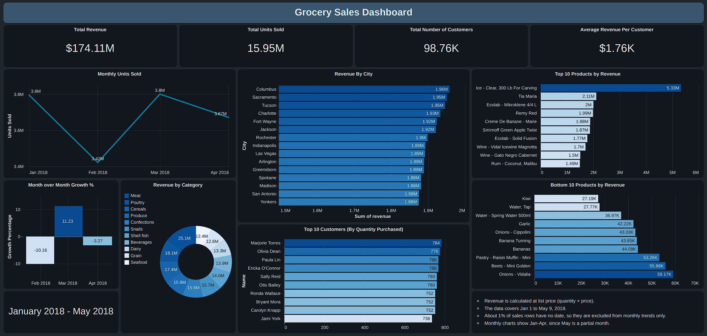
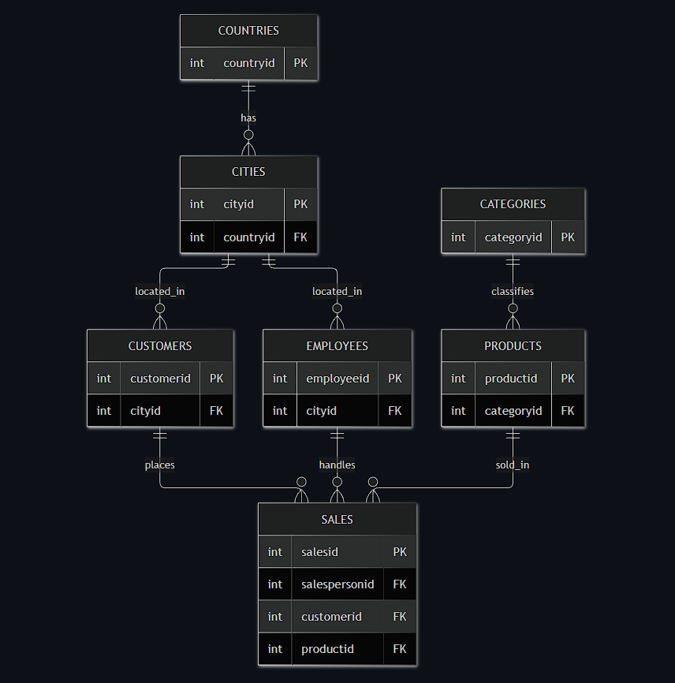

# Grocery Sales Analytics in Databricks

An end-to-end analytics project on a grocery sales dataset (6.7M sales lines, 98.8K customers, 452 products). Raw CSVs are loaded into Delta tables in Unity Catalog, modeled as a star schema, validated with data quality checks, analyzed with SQL, and presented in a Databricks dashboard.

**Tools:** Databricks, Unity Catalog, Delta Lake, PySpark, SQL



## At a glance

- Loaded 7 CSVs into Delta tables with PySpark and modeled them as a star schema with primary and foreign keys.
- Wrote 8 gold views using multi-table joins, CTEs, and window functions (`LAG`, `RANK`, `ROW_NUMBER`).
- Validated the data before trusting it: join fan-out checks, orphan records, null dates, and type fixes.
- Built a one-page dashboard with revenue, trend, product, category, city, and customer views.

## Business questions

1. How much revenue does the business generate, and how is it trending month to month?
2. Which product categories and products drive revenue, and which sell the least?
3. How is revenue distributed across cities?
4. Who are the top customers, and what does an average customer spend?

## Key findings

- **Scale:** $174.1M in revenue from 15.95M units sold to 98.8K customers between Jan 1 and May 9, 2018, about $1.76K per customer over the period.
- **Daily revenue is flat.** Month-over-month growth is -10.2% (Feb), +11.2% (Mar), and -3.3% (Apr), but those swings almost exactly match the number of days in each month (28, 31, 30). Adjusted for days, daily revenue stays within about ±0.5%. This comes from the synthetic data, since a real business would normally show seasonality.
- **Categories are evenly spread.** Eleven categories each contribute roughly 7% to 14% of revenue. Meat is the largest at about $25.1M (about 14%).
- **No geographic concentration.** The 96 cities each bring in between about $1.64M and $1.96M (average about $1.81M), so the top city is only about 19% above the lowest.
- **Price drives product rankings.** The top products are high-priced items (a $5.3M carving ice block, liqueurs, cleaning chemicals) and the bottom are low-priced items (kiwi, tap water). Quantities in the source data are random, so price is what separates products.

## Results by view

Each block shows the query behind one gold view and its output. Each file in `02_gold_views.sql/` starts with `CREATE OR REPLACE VIEW`, and the snippets below show only the query. Every output is also saved as a CSV in `query_outputs/`.

### 1. `monthly_sales`: monthly revenue and growth

```sql
WITH monthly AS (
  SELECT
      DATE_TRUNC('month', s.salesdate) AS month,
      SUM(s.quantity * p.price)        AS revenue,
      SUM(s.quantity)                  AS units_sold
  FROM grocery_sales.default.sales s
  JOIN grocery_sales.default.products p ON s.productid = p.productid
  WHERE s.salesdate IS NOT NULL
    AND s.salesdate < '2018-05-01'
  GROUP BY DATE_TRUNC('month', s.salesdate)
)
SELECT
    month, revenue, units_sold,
    LAG(revenue) OVER (ORDER BY month) AS prev_month_revenue,
    revenue - LAG(revenue) OVER (ORDER BY month) AS revenue_change,
    ROUND((revenue - LAG(revenue) OVER (ORDER BY month))
          / NULLIF(LAG(revenue) OVER (ORDER BY month), 0) * 100, 2) AS mom_growth_pct
FROM monthly;
```

| Month    | Revenue     | Units sold | MoM growth |
| -------- | ----------- | ---------- | ---------- |
| Jan 2018 | $41,494,238 | 3,795,578  | n/a        |
| Feb 2018 | $37,277,609 | 3,421,656  | -10.16%    |
| Mar 2018 | $41,462,454 | 3,800,520  | +11.23%    |
| Apr 2018 | $40,106,724 | 3,671,271  | -3.27%     |

Growth tracks the number of days in each month (31, 28, 31, 30), so daily revenue is flat (see the next view). May is excluded because it only has 9 days. The first version of this query compared January against a group of undated rows and reported a 2,285% jump, which led to the null-date check below.

Full output: [`query_outputs/monthly_sales.csv`](query_outputs/monthly_sales.csv)

### 2. `days_with_sales`: data coverage and daily revenue

```sql
WITH monthly AS (
  SELECT
      DATE_TRUNC('month', s.salesdate)  AS month,
      SUM(s.quantity * p.price)         AS revenue,
      COUNT(DISTINCT DATE(s.salesdate)) AS days_with_sales
  FROM grocery_sales.default.sales s
  JOIN grocery_sales.default.products p ON s.productid = p.productid
  WHERE s.salesdate IS NOT NULL
  GROUP BY DATE_TRUNC('month', s.salesdate)
)
SELECT
    month, revenue, days_with_sales,
    ROUND(revenue / days_with_sales, 2) AS avg_daily_revenue
FROM monthly;
```

| Month    | Revenue     | Days with sales | Avg daily revenue |
| -------- | ----------- | --------------- | ----------------- |
| Jan 2018 | $41,494,238 | 31              | $1,338,524        |
| Feb 2018 | $37,277,609 | 28              | $1,331,343        |
| Mar 2018 | $41,462,454 | 31              | $1,337,499        |
| Apr 2018 | $40,106,724 | 30              | $1,336,891        |
| May 2018 | $12,030,719 | 9               | $1,336,747        |

Every day from Jan 1 to May 9 has sales, and average daily revenue is nearly identical in every month (within about 0.5%), including the partial month of May. The monthly differences come from the number of days.

Full output: [`query_outputs/days_with_sales.csv`](query_outputs/days_with_sales.csv)

### 3. `revenue_by_category`: revenue per product category

```sql
SELECT
    c.categoryname,
    ROUND(SUM(s.quantity * p.price)) AS revenue
FROM grocery_sales.default.sales s
JOIN grocery_sales.default.products p
    ON s.productid = p.productid
JOIN grocery_sales.default.categories c
    ON p.categoryid = c.categoryid
GROUP BY c.categoryname
ORDER BY 2 DESC;
```

| Category    | Revenue     | Share |
| ----------- | ----------- | ----- |
| Meat        | $25,098,807 | 14.4% |
| Poultry     | $18,090,725 | 10.4% |
| Cereals     | $17,433,489 | 10.0% |
| Produce     | $15,845,769 | 9.1%  |
| Confections | $15,819,757 | 9.1%  |
| Snails      | $15,676,861 | 9.0%  |
| Shell fish  | $14,035,020 | 8.1%  |
| Beverages   | $13,858,659 | 8.0%  |
| Dairy       | $13,265,641 | 7.6%  |
| Grain       | $12,612,547 | 7.2%  |
| Seafood     | $12,367,896 | 7.1%  |

Revenue is spread across all 11 categories, from 7% to 14% each. Meat's lead comes partly from a single $5.3M item, the carving ice block, which the dataset files under Meat.

Full output: [`query_outputs/revenue_by_category.csv`](query_outputs/revenue_by_category.csv)

### 4. `sales_by_city`: transactions, volume, and revenue per city

```sql
SELECT
    cities.cityname,
    COUNT(*) AS number_of_transactions,
    SUM(sales.quantity) AS volume,
    ROUND(SUM(sales.quantity * prod.price), 0) AS revenue
FROM grocery_sales.default.sales sales
JOIN grocery_sales.default.products prod
    ON sales.productid = prod.productid
JOIN grocery_sales.default.customers cust
    ON sales.customerid = cust.customerid
JOIN grocery_sales.default.cities cities
    ON cust.cityid = cities.cityid
GROUP BY cities.cityname
ORDER BY revenue DESC;
```

| City       | Transactions | Units   | Revenue    |
| ---------- | ------------ | ------- | ---------- |
| Columbus   | 74,902       | 178,502 | $1,958,764 |
| Sacramento | 74,564       | 179,186 | $1,951,153 |
| Tucson     | 75,674       | 179,162 | $1,946,725 |
| Charlotte  | 74,127       | 177,022 | $1,933,691 |
| Fort Wayne | 75,130       | 176,721 | $1,923,741 |
| ...        | ...          | ...     | ...        |
| Omaha      | 68,489       | 154,861 | $1,677,821 |
| Long Beach | 69,361       | 151,336 | $1,641,269 |

The 96 cities range from $1.64M to $1.96M in revenue (average about $1.81M), so the top city is only about 19% above the lowest and no city dominates. Transactions across all cities add up to 6,758,125, matching the total number of sales rows, so no sales were lost in the joins.

Full output: [`query_outputs/sales_by_city.csv`](query_outputs/sales_by_city.csv)

### 5. `revenue_per_salesperson`: employee ranking

```sql
SELECT
    e.firstname,
    e.lastname,
    ROUND(SUM(s.quantity * p.price), 0) AS revenue,
    RANK() OVER(ORDER BY SUM(s.quantity * p.price) DESC) AS Rank
FROM grocery_sales.default.sales s
JOIN grocery_sales.default.employees e
    ON s.salespersonid = e.employeeid
JOIN grocery_sales.default.products p
    ON s.productid = p.productid
GROUP BY e.firstname, e.lastname;
```

| Rank | Salesperson     | Revenue    |
| ---- | --------------- | ---------- |
| 1    | Lindsay Chen    | $7,643,380 |
| 2    | Shelby Riddle   | $7,639,279 |
| 3    | Desiree Stuart  | $7,635,863 |
| 4    | Darnell Nielsen | $7,621,381 |
| 5    | Katina Marks    | $7,618,530 |
| ...  | ...             | ...        |
| 23   | Seth Franco     | $7,471,475 |

All 23 salespeople are within about 2.3% of each other ($7.47M to $7.64M).

Full output: [`query_outputs/revenue_per_salesperson.csv`](query_outputs/revenue_per_salesperson.csv)

### 6. `top_customers`: highest-volume customers

```sql
SELECT
    c.customerid,
    c.firstname,
    c.lastname,
    c.full_name,
    SUM(s.quantity) AS total_quantity
FROM grocery_sales.default.customers c
JOIN grocery_sales.default.sales s
    ON c.customerid = s.customerid
GROUP BY c.customerid, c.firstname, c.lastname, c.full_name
ORDER BY total_quantity DESC
LIMIT 10;
```

| #   | Customer        | Customer ID | Total quantity |
| --- | --------------- | ----------- | -------------- |
| 1   | Marjorie Torres | 95963       | 784            |
| 2   | Olivia Dean     | 95972       | 776            |
| 3   | Ericka O'Connor | 95048       | 768            |
| 4   | Paula Lin       | 95157       | 768            |
| 5   | Otis Bailey     | 98675       | 760            |
| 6   | Sally Reid      | 95047       | 760            |
| 7   | Bryant Mora     | 97486       | 752            |
| 8   | Carolyn Knapp   | 96763       | 752            |
| 9   | Ronda Wallace   | 97863       | 752            |
| 10  | Kelly Best      | 98303       | 736            |

The top customer bought about 4.9 times the average of roughly 160 units per customer over the period. Several customers tie on quantity (for example three at 736 units), so the last row can vary between runs.

Full output: [`query_outputs/top_customers.csv`](query_outputs/top_customers.csv)

### 7. `top_bottom_products`: best and worst sellers by revenue

```sql
WITH product_revenue AS (
SELECT
    p.productid,
    p.productname,
    ROUND(SUM(s.quantity * p.price), 0) AS revenue
FROM grocery_sales.default.sales s
JOIN grocery_sales.default.products p
    ON s.productid = p.productid
GROUP BY p.productid, p.productname
),

ranked AS (
SELECT
    *,
    RANK() OVER(ORDER BY revenue DESC) AS rank_top,
    RANK() OVER(ORDER BY revenue ASC) AS rank_bottom
FROM product_revenue
)

SELECT
    productid,
    productname,
    revenue,
    rank_top,
    CASE WHEN rank_top <= 10 THEN 'Top 10' ELSE 'Bottom 10' END AS group_label
FROM ranked
WHERE rank_top <= 10 OR rank_bottom <= 10
ORDER BY revenue DESC;
```

| Group  | Product                         | Revenue    |
| ------ | ------------------------------- | ---------- |
| Top    | Ice - Clear, 300 Lb For Carving | $5,328,858 |
| Top    | Tia Maria                       | $2,113,097 |
| Top    | Ecolab - Mikroklene 4/4 L       | $2,001,224 |
| Top    | Remy Red                        | $1,987,476 |
| Top    | Creme De Banane - Marie         | $1,880,534 |
| Bottom | Kiwi                            | $27,187    |
| Bottom | Water, Tap                      | $27,766    |
| Bottom | Water - Spring Water 500ml      | $36,966    |
| Bottom | Garlic                          | $42,223    |
| Bottom | Onions - Cippolini              | $43,025    |

Rankings follow price, because quantities in the source data are random. The view returns 20 rows (10 top and 10 bottom of 452 products).

Full output: [`query_outputs/top_bottom_products.csv`](query_outputs/top_bottom_products.csv)

### 8. `top_products_per_category`: top 3 products within each category

```sql
WITH sort_by_category AS (
SELECT
    c.categoryname,
    p.productname,
    ROUND(SUM(p.price * s.quantity), 0) AS revenue,
    ROW_NUMBER() OVER(PARTITION BY c.categoryname ORDER BY SUM(p.price * s.quantity) DESC) AS row_num
FROM grocery_sales.default.sales s
JOIN grocery_sales.default.products p
    ON s.productid = p.productid
JOIN grocery_sales.default.categories c
    ON p.categoryid = c.categoryid
GROUP BY categoryname, p.productname
)

SELECT
    categoryname,
    productname,
    revenue,
    row_num
FROM sort_by_category
WHERE row_num <= 3;
```

Four of the eleven categories shown:

| Category  | Rank | Product                         | Revenue    |
| --------- | ---- | ------------------------------- | ---------- |
| Meat      | 1    | Ice - Clear, 300 Lb For Carving | $5,328,858 |
| Meat      | 2    | Rum - Coconut, Malibu           | $1,487,466 |
| Meat      | 3    | Ecolab - Lime - A - Way 4/4 L   | $1,234,331 |
| Beverages | 1    | Tia Maria                       | $2,113,097 |
| Beverages | 2    | Jagermeister                    | $1,449,566 |
| Beverages | 3    | Halibut - Steaks                | $1,008,328 |
| Cereals   | 1    | Wine - Vidal Icewine Magnotta   | $1,703,597 |
| Cereals   | 2    | Rum - Mount Gay Eclipes         | $1,438,764 |
| Cereals   | 3    | Scallops - Live In Shell        | $1,112,180 |
| Poultry   | 1    | Campari                         | $1,110,137 |
| Poultry   | 2    | Scallop - St. Jaques            | $1,083,457 |
| Poultry   | 3    | Table Cloth 54x72 White         | $964,886   |

The view returns 33 rows (3 per category). Category labels in the source data don't always match the product names (wine under Cereals, a table cloth under Poultry, rum and a cleaning chemical under Meat, halibut under Beverages), so category results reflect the dataset's labels, not real product types.

Full output: [`query_outputs/top_products_per_category.csv`](query_outputs/top_products_per_category.csv)

### Data quality findings

| Check                                             | Result                                           |
| ------------------------------------------------- | ------------------------------------------------ |
| Sales rows                                        | 6,758,125                                        |
| Rows after joining `sales` to `products`          | 6,758,125 (no duplicates, none dropped)          |
| Sales rows after joining `customers` and `cities` | 6,758,125 (none dropped)                         |
| Sales rows with no `salesdate`                    | 67,526 (about 1%)                                |
| Date coverage                                     | Jan 1 to May 9, 2018, with sales on all 129 days |

## Architecture

```
Kaggle CSVs -> Unity Catalog volume -> Delta tables -> Gold Views -> Dashboard
```

- **Raw files:** CSVs in the `grocery_sales.default.grocerydata_csvs` volume.
- **Tables:** seven Delta tables in `grocery_sales.default`, loaded with PySpark, with column names cleaned and types fixed (for example `price` cast to `DECIMAL(10,2)`). A `full_name` column was added to `customers` for readable dashboard labels.
- **Gold:** eight views in `grocery_sales.gold` that join the tables directly and feed the dashboard.

| View                        | What it answers                                                            |
| --------------------------- | -------------------------------------------------------------------------- |
| `monthly_sales`             | Monthly revenue and units, with month-over-month growth (Jan-Apr)          |
| `days_with_sales`           | Days with recorded sales, used to check coverage and the partial May month |
| `revenue_by_category`       | Revenue per product category                                               |
| `sales_by_city`             | Revenue per city                                                           |
| `revenue_per_salesperson`   | Revenue per employee, ranked                                               |
| `top_bottom_products`       | Top 10 and bottom 10 products by revenue                                   |
| `top_products_per_category` | Best-selling products within each category                                 |
| `top_customers`             | Highest-spending and highest-volume customers                              |

### Data model

Star schema with `sales` as the fact table. Primary and foreign keys are declared in `00_schema_constraints.sql/schema_constraints.sql`. Databricks does not enforce these constraints. They document the relationships and drive the ER diagram in Catalog Explorer.



## Data quality checks

Run from the `01_data_quality.sql/` folder (`join_count_vs_non_join_count.sql`, `salesid_duplication_check.sql`, `total_distinct_days.sql`, and others):

- **Join safety:** no duplicate `productid` values in `products`, no sales with a missing product, and `sales` has the same row count as `sales JOIN products`, so joins neither inflate nor drop revenue.
- **Referential integrity:** no orphan records between employees and cities (and the other key relationships).
- **Date coverage:** sales span Jan 1 to May 9, 2018, with sales on all 129 days. May has only 9 days, so it is excluded from monthly trends and growth.
- **Missing dates:** 67,526 sales rows (about 1%) have no `salesdate`. They stay in totals and breakdowns but are excluded from time-based charts.
- **Type fixes:** `price` was inferred as `double`, so it was cast to `DECIMAL(10,2)` to avoid floating-point noise. Delta cannot `ALTER` a `DOUBLE` column to `DECIMAL`, so the table was recreated with a cast.

## Repository structure

```
.
├── README.md
├── dashboard/
│   └── Grocery_Sales_Dashboard.png
├── query_outputs/                      # output of each gold view as CSV (8 files)
├── notebooks/
│   ├── kagglehub_import.ipynb          # download the Kaggle dataset into the volume
│   └── volumes_to_delta_tables.ipynb   # load CSVs into Delta tables
├── 00_schema_constraints.sql/
│   └── schema_constraints.sql          # primary and foreign keys
├── 01_data_quality.sql/                # data checks and table preparation
│   ├── 10_row_previews.sql
│   ├── alter_product_price_type.sql
│   ├── creation_of_gold_schema.sql
│   ├── customers_add_full_name.sql
│   ├── customers_with_no_purchases.sql
│   ├── join_count_vs_non_join_count.sql
│   ├── salesid_duplication_check.sql
│   └── total_distinct_days.sql
└── 02_gold_views.sql/                  # the eight gold views for the dashboard
    ├── days_with_sales.sql
    ├── monthly_sales.sql
    ├── revenue_by_category.sql
    ├── revenue_per_salesperson.sql
    ├── sales_by_city.sql
    ├── top_bottom_products.sql
    ├── top_customers.sql
    └── top_products_per_category.sql
```

The full `sales.csv` (about 517 MB) is not included. Download the dataset from [Kaggle](https://www.kaggle.com/datasets/andrexibiza/grocery-sales-dataset).

## How to reproduce

1. Run `notebooks/kagglehub_import.ipynb` to download the dataset and copy the CSVs into a Unity Catalog volume.
2. Run `notebooks/volumes_to_delta_tables.ipynb` to load the CSVs into Delta tables.
3. From `01_data_quality.sql/`, run `alter_product_price_type.sql`, `customers_add_full_name.sql`, and `creation_of_gold_schema.sql`, then the checks.
4. Run `00_schema_constraints.sql/schema_constraints.sql` after the tables are in their final form, because `CREATE OR REPLACE TABLE` removes constraints.
5. Run each view in `02_gold_views.sql/`.
6. Build the dashboard on the gold views.

Do not open the CSVs in Excel before uploading. Excel rewrites timestamps when it saves a CSV, which corrupted the `ModifyDate` column during this project.

## Skills demonstrated

- Data loading and modeling in Databricks with Unity Catalog, Delta tables, and views
- PySpark ingestion with schema handling and type fixes
- SQL: CTEs, window functions (`LAG`, `RANK`, `ROW_NUMBER`), inner, left, and anti-joins, aggregation
- Data quality validation: join fan-out checks, orphan detection, null analysis
- Dimensional modeling (star schema, primary and foreign keys) and layering curated gold views on top of raw tables
- Dashboard design and data storytelling

## Limitations and next steps

- Data is synthetic, so trends are flat and rankings follow price. Findings illustrate the analysis method, not real business conclusions.
- Prices and quantities in the source data appeared randomly generated, so values were rescaled for realistic totals. Absolute numbers will differ from the raw Kaggle data.
- Each gold view repeats its own joins and reads live from the tables. A single wide joined table (for example `sales_enriched`) would centralize the logic and avoid re-running the joins on every query.

For more details see <a href="https://github.com/apurewal19/grocery-sales-databricks">Project Files</a>
